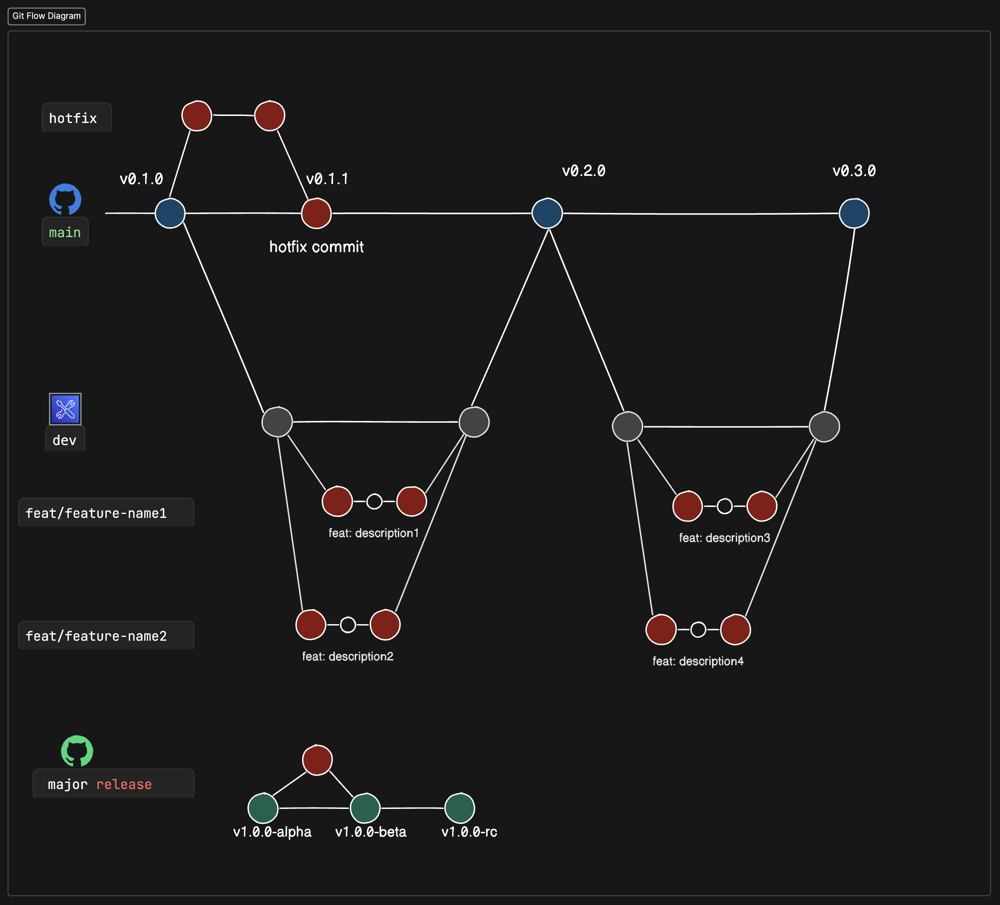

# GIT COMMIT CONVENTIONS

## Introduction
> A commit message indicates how a developer is great collaborator

## Vscode Extension

```
Name: Conventional Commits
Id: vivaxy.vscode-conventional-commits
Description: 💬Conventional Commits for VSCode.
Version: 1.25.0
Publisher: vivaxy
VS Marketplace Link: https://marketplace.visualstudio.com/items?itemName=vivaxy.vscode-conventional-commits
```

## Commit Structure
```
<!-- Subject Line: -->
<type>[optional scope]:<description>

<!-- Body Line  -->
[optional body]
Because:
- [relevant context]
- [why you decided to change things]
- [reason you're doing it now] 
 
<!-- Footer Line -->
[optional footer]

```

### Subject Line
#### Type
  - **feat**: use for code features -> MINOR RELEASE
  - **fix**: use for bug fixes -> PATCH RELEASE
  - **docs**: use for docs like .md, .yml .etc
  - **style**: use for commits, that do not affect the meaning (white space, formatting, missing semi-colons, etc)
  - **refactor**: use for code refactoring but not change any behaviour
  - **perf**: use for refactoring commits, that improve performance
  - **test**: use for adding test files, correcting files
  - **build**: use for built resources
  - **ci**: use for continuous intregrations
  - **chore**: use for small updates eg. .gitmessage, composer.json
  - **revert**: use for return from a commit
  
#### Optional Scope:
  - additional info
  - with nouns

#### Description:
  - short
  - imperative
  <!-- - start with uppercase -->
  - do not use a period mark in end of subject
  - up to 50 characters

### Body Area
#### Optional Body:
  - explain in way you want
  - detailed
  - why, how, what

### Footer Area
#### Optional Footer:
  - followed by either a :<sub>space</sub> or <sub>space</sub># separator, 
  - followed by a string value
  - use **"-"** in place of whitespace characters (kebabcase)

### Examples

**Commit message with description and breaking change footer**
```
feat: allow provided config object to extend other configs

BREAKING CHANGE: `extends` key in config file is now used for extending other config files

```

**Commit message with ! to draw attention to breaking change**
```
feat!: send an email to the customer when a product is shipped
```

**Commit message with scope and ! to draw attention to breaking change**
```
feat(api)!: send an email to the customer when a product is shipped
```

**Commit message with both ! and BREAKING CHANGE footer**
```
chore!: drop support for Node 6

BREAKING CHANGE: use JavaScript features not available in Node 6.
```

**Commit message with no body**
```
docs: correct spelling of CHANGELOG
```

**Commit message with scope**
```
feat(lang): add Polish language
```

**Commit message with multi-paragraph body and multiple footers**
```
fix: prevent racing of requests

Introduce a request id and a reference to latest request. Dismiss
incoming responses other than from latest request.

Remove timeouts which were used to mitigate the racing issue but are
obsolete now.

Reviewed-by: Z
Refs: #123
```

<!-- ****
```

``` -->



# COMPOSER VERSIONING

## Version Range (>,=,<,!)
  - >=1.0
  - >=1.0 <2.0
  - >=1.0 <1.1 || >=1.2

## Hyphenated Version Range (-)
  - 1.0.0 - 2.1.0 :: >=1.0.0 <=2.1.0

## Wildcard Version Range (.*)
  - 1.*   :: >=1.0 <2.0
  - 1.0.* :: >=1.0 <1.1

## Tilde Version Range (~)
  - ~1.2   :: >=1.2 < 2.0.0
  - ~1.2.3 :: >=1.2.3 <1.3.0

## Caret Version Range (^)
  - ^1.2.3 :: >=1.2.3 <2.0.0
  - ^0.3   :: >=0.3.0 <0.4.0
  - ^0.0.3 :: >=0.0.3 <0.0.4
